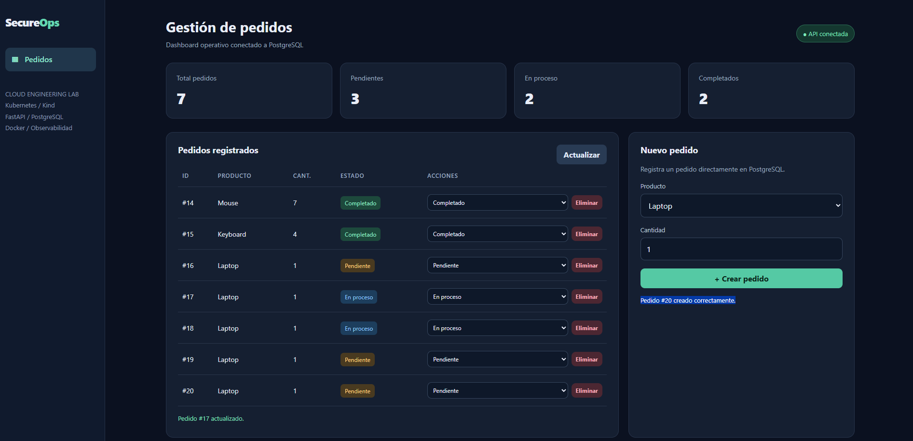
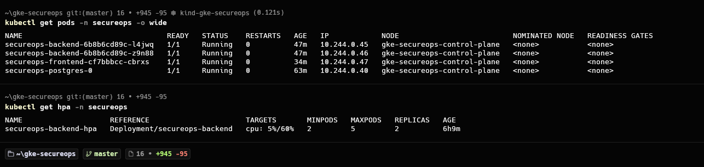
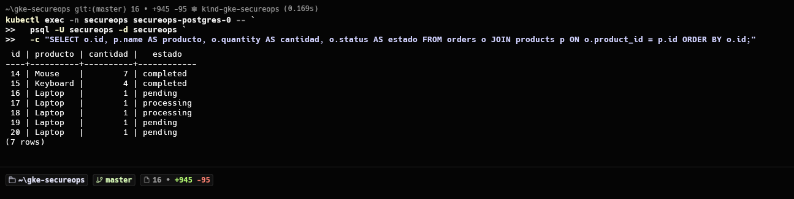
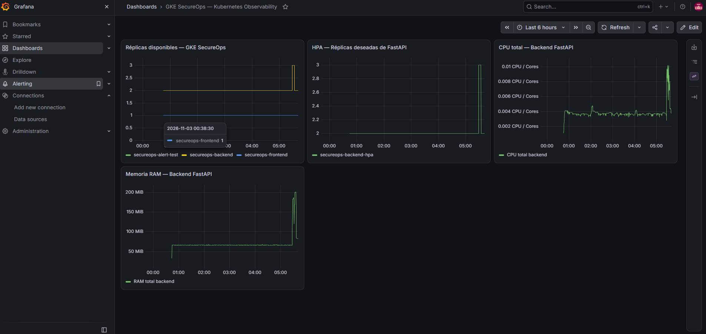
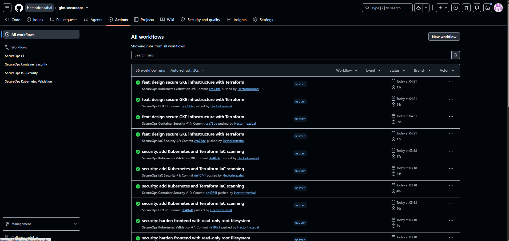

# ☁️ GKE SecureOps

**Kubernetes · Cloud Engineering · DevSecOps**

Una aplicación real de **gestión de pedidos** que utilizo para demostrar despliegue, escalamiento, persistencia SQL, observabilidad y seguridad en Kubernetes.



## 🎯 ¿Qué hace?

Desde el dashboard se pueden **crear, consultar, actualizar y eliminar pedidos**. Una API REST en FastAPI procesa las solicitudes y guarda los datos en PostgreSQL. El frontend, el backend y la base de datos se ejecutan en **Kubernetes (Kind)**.

```text
Navegador → Nginx → FastAPI (HPA: 2–5 Pods) → PostgreSQL → PVC
                       │
              Monitoreo del clúster
              Prometheus + Grafana
```

## 🛠️ Lo que demuestra

| Área | Implementación |
| --- | --- |
| **Kubernetes** | Deployments, Services, StatefulSet, PVC y HPA |
| **Backend y datos** | FastAPI, API REST CRUD, PostgreSQL y SQL |
| **Seguridad** | ServiceAccounts, RBAC, Secrets, NetworkPolicies y contenedores restringidos |
| **Observabilidad** | Prometheus, Grafana y reglas de alerta |
| **Automatización** | GitHub Actions: tests, validación Kubernetes y análisis con Trivy |
| **Google Cloud / IaC** | Terraform para VPC, GKE privado, nodos e IAM (diseño validado) |

## 📸 Evidencia técnica

<details>
<summary><strong>Ver Kubernetes, PostgreSQL, Grafana y CI/CD</strong></summary>

**Kubernetes y HPA:** Pods en ejecución y escalamiento configurado.



**PostgreSQL:** los siete pedidos del dashboard corresponden a registros consultados con SQL.



**Grafana:** réplicas, HPA, CPU y RAM del backend.



**GitHub Actions:** ejecuciones exitosas de los workflows mostradas en la captura.



</details>

## 🚀 Probar el dashboard

Con Docker Desktop y el clúster Kind **ya creado y desplegado**:

```powershell
kubectl get pods -n secureops
kubectl port-forward -n secureops service/secureops-frontend 8081:8080
```

Abrir **http://localhost:8081**.

> Para instalar el entorno desde cero se requieren los manifiestos Kubernetes, las imágenes de contenedores y el Secret de PostgreSQL. El `port-forward` solo abre una instalación existente.

## ☁️ ¿Dónde está desplegado?

- **Funcional hoy:** Kind local + PostgreSQL persistente mediante PVC, sin consumo de recursos de pago en GCP.
- **Preparado para Google Cloud:** infraestructura de GKE descrita en Terraform y manifiestos de adaptación. **GKE no está desplegado**.

**Objetivo:** un proyecto de portafolio reproducible para roles **Cloud Engineer / DevSecOps**, mostrando tanto una aplicación funcional como las prácticas necesarias para operarla.
